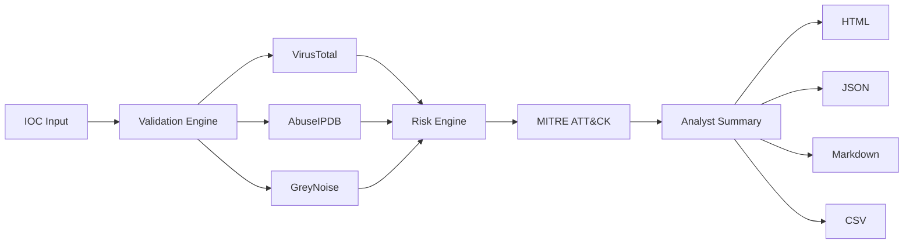

# IOC Intelligence Analyzer

**Enterprise-grade threat-intelligence aggregation for SOC teams.** Validate indicators of compromise (IOCs), enrich them from VirusTotal, AbuseIPDB and GreyNoise, score risk deterministically, map findings to MITRE ATT&CK, and generate analyst-ready reports in HTML, JSON, Markdown and CSV — all from a single CLI.

[](LICENSE)
[](https://python.org)
[](CHANGELOG.md)
[](pyproject.toml)

---

## Project Overview

The **IOC Intelligence Analyzer** is a security automation platform that turns raw indicators — suspicious IPs, domains, URLs, file hashes, email addresses — into defensible, evidence-backed risk assessments. It is designed for teams that need repeatable triage without building bespoke glue code against each threat-intel vendor.

Every point in the final risk score is traceable to a named provider signal, every report field is sanitised against injection attacks, and private/reserved address space never leaves the machine.

## Business Problem

Security operations teams drown in indicators:

- **Fragmented intelligence.** No single provider covers everything; analysts copy-paste between three or four web portals per alert.
- **Slow triage.** Manual lookups add minutes to each investigation; at scale this is the difference between containment and breach.
- **Inconsistent risk language.** "High confidence" means different things in VT, AbuseIPDB and GreyNoise. Teams lack one explainable score.
- **Reporting friction.** Findings rarely make it out of the tool that produced them — no clean handoff to ticketing, wikis, or leadership.
- **Privacy exposure.** Naive tooling ships internal IPs and sensitive domains to external APIs.

This project solves all five with one auditable pipeline: **validate → enrich → score → map → report**.

## Features

| Feature | Description |
|---|---|
| Multi-type IOC validation | IPv4, IPv6, domain, URL, MD5/SHA1/SHA256, email — RFC-compliant, strict |
| Provider enrichment | VirusTotal v3, AbuseIPDB v2, GreyNoise with bounded retries + backoff |
| Deterministic risk engine | Explainable score factors; frozen weights table; provider failures never inflate risk |
| MITRE ATT&CK mapping | Evidence-based tactic/technique assertions with rationale per mapping |
| Analyst summaries | Executive summary, threat assessment, recommended actions, escalation guidance |
| Four report formats | HTML (CSP-hardened), JSON (machine-readable), Markdown, CSV (formula-injection safe) |
| Bulk analysis | Newline or CSV indicator files with header auto-detection and dedupe |
| Offline & demo modes | `--offline` skips all network calls; `--demo` produces a full sample report with zero keys |
| Privacy guardrails | Private/reserved IP ranges are never sent to external providers |
| Structured logging | Human or JSON logs to stderr for SIEM shipping; secrets redacted |

## Supported IOC Types

| Type | Example | Validation rules |
|---|---|---|
| `ipv4` | `203.0.113.66` | Octet range, canonical form; private/reserved detected |
| `ipv6` | `2001:db8::1` | Full/compressed forms, scope-safe parsing |
| `domain` | `evil-corp.example` | RFC-1123 labels ≤63 chars, hostname ≤253 chars |
| `url` | `https://a.b/c` | Scheme + host + hostname validator shared with domains |
| `md5` / `sha1` / `sha256` | `d41d8cd9…` | Exact hex length + charset |
| `email` | `phish@example.com` | Local-part + validated domain |

## Threat Intelligence Providers

**Active (Release 1):**

- **[VirusTotal](https://www.virustotal.com)** — multi-engine detections, reputation categories, relationships. Primary malware/C2 signal.
- **[AbuseIPDB](https://www.abuseipdb.com)** — community abuse reports, confidence score, attack categories, ISP/usage context.
- **[GreyNoise](https://www.greynoise.io)** — internet-noise classification (`botnet`, `malicious`, `suspicious`, `benign`) plus Tor detection.

**Planned stubs (present, return `SKIPPED` rows with consistent structure):** AlienVault OTX · URLHaus · Shodan · WHOIS · DNS resolution. See [docs/THREAT_INTELLIGENCE_SOURCES.md](docs/THREAT_INTELLIGENCE_SOURCES.md).

## Risk Scoring Methodology

Scores are deterministic, clamped to 0–100, and fully explained. Each awarded point set is recorded as a `ScoreFactor` with a human-readable rationale visible in every report.

| Signal | Points |
|---|---|
| VirusTotal malicious verdicts | +30 |
| AbuseIPDB confidence ≥ threshold | +25 |
| Known botnet involvement | +20 |
| Malware hosting classification | +15 |
| Suspicious WHOIS signals | +10 |
| GreyNoise verdict / multi-provider corroboration | calibrated inline |

**Risk bands:** `0–20 Informational · 21–40 Low · 41–60 Medium · 61–80 High · 81–100 Critical`

Design guarantees: connector errors contribute **zero** points; identical inputs always produce identical scores; weights live in one frozen table (`SCORING_RULES`) for future tuning without algorithm changes.

## MITRE ATT&CK Mapping

Findings map to published Enterprise ATT&CK IDs through a deterministic rule table — only techniques with a defensible evidence trail are asserted, and each mapping carries its rationale for analyst accept/reject during triage. Examples: botnet/C2 labels → `T1071 Application Layer Protocol`; Tor/onion infrastructure → `T1090 Proxy`; DNS-tunneling labels → `T1071.004`. LLM-assisted refinement is planned behind the same interface (v3.0).

## Security Controls

Built by security engineers, for security engineers:

- **Stored-XSS defence with forensic fidelity** — IOC *evidence* fields render verbatim via `html.escape()` (payloads remain visible but inert); *narrative* fields additionally pass through `_neutralize_text()` which strips `<>"'&\`` characters and neutralises `on*=` event handlers and `javascript:` schemes so hostile payloads can never appear executable inside analyst prose.
- **Content-Security-Policy** meta headers on HTML reports; no inline scripting.
- **CSV formula-injection protection** — leading `= + - @` and control characters neutralised in every exported cell.
- **Path-traversal-safe filenames** — IOC-derived report names sanitised (dot-runs collapsed, unsafe characters removed) while preserving forensic tokens like `203.0.113.66`.
- **Private/reserved IP protection** — RFC1918, loopback and link-local addresses are never transmitted to external providers.
- **Secret redaction** — API keys are read from environment/`.env` only, never logged or serialised into reports; config repr redacts credentials.
- **Bounded network behaviour** — per-request timeouts, capped retries with exponential backoff; no unbounded fan-out.

## Architecture



Layered design: `app/core` (models, validation, config, logging) → `app/connectors` (provider HTTP + normalisation) → `app/services` (analyzer orchestration, scoring, MITRE, summary) → `app/reporting` (renderers). The CLI (`main.py`) is a thin transport layer. Full detail in [docs/ARCHITECTURE.md](docs/ARCHITECTURE.md).

## Installation

```bash
git clone https://github.com/securitymonkey/ioc-intelligence-analyzer.git
cd ioc-intelligence-analyzer
python -m venv .venv && source .venv/bin/activate
pip install -r requirements.txt
```

Or as a package: `pip install .` exposing the `ioc-analyzer` command. Detailed guide: [docs/INSTALL.md](docs/INSTALL.md).

## Configuration

```bash
cp .env.example .env   # then edit
```

| Variable | Purpose | Default |
|---|---|---|
| `VT_API_KEY` | VirusTotal v3 key | – |
| `ABUSEIPDB_API_KEY` | AbuseIPDB v2 key | – |
| `GREYNOISE_API_KEY` | GreyNoise key | – |
| `IOC_LOG_LEVEL` | DEBUG/INFO/WARNING/ERROR | INFO |
| `IOC_JSON_LOGS` | Structured logs | false |
| `IOC_REPORT_DIR` | Output directory | reports |
| `IOC_OFFLINE` | Skip all network calls | false |
| `IOC_TIMEOUT_SECONDS` / `IOC_MAX_RETRIES` / `IOC_BACKOFF_FACTOR` | Connector hardening | 15 / 3 / 0.7 |

Missing keys degrade gracefully: affected providers report `CONFIGURATION_ERROR` rows with the same structure as successful ones — never a crash, never an inflated score.

## Usage

```text
usage: ioc-analyzer [-h] [--ioc IOC | --bulk FILE | --demo | --validate VALUE]
                    [--format FORMAT] [--output OUTPUT] [--offline]
                    [--log-level LOG_LEVEL] [--json-logs] [--version]
```

### CLI Examples

```bash
# Single indicator, all formats
python main.py --ioc 203.0.113.66

# One format, custom output directory
python main.py -i evil.example -f html,json -o ./out

# Format check without enrichment (no keys needed)
python main.py --validate "https://a.b/c"

# Privacy-preserving run (no outbound calls)
python main.py -i 198.51.100.7 --offline
```

### Bulk Analysis

```bash
python main.py --bulk examples/indicators.csv
python main.py -b indicators.txt --format csv --offline
```

Bulk files may be newline-delimited or CSV. Headers (`ioc`, `indicator`, `value`, `ioc_value`) are auto-detected and skipped in both modes; duplicates are partitioned and deduped consistently with standalone validation.

### Offline Demo Mode

```bash
python main.py --demo
```

Generates a complete multi-format analyst report from synthetic data — no network, no API keys. Ideal for evaluating report quality or CI pipelines.

## Report Formats

| Format | Audience | Notes |
|---|---|---|
| **HTML** | Analysts, management | Self-contained, CSP-hardened, XSS-safe evidence/narrative split |
| **JSON** | SOAR/SIEM ingestion | Stable schema: assessment, score factors, enrichments, MITRE, summary |
| **Markdown** | Wikis, tickets | Paste-ready for Jira/Confluence/GitHub |
| **CSV** | Spreadsheet triage | Formula-injection neutralised |

## Testing

```bash
PYTEST_DISABLE_PLUGIN_AUTOLOAD=1 python -m pytest -q        # suite
./scripts/run_tests.sh                                       # verbose + coverage gate
```

210 tests across unit and integration layers, including a dedicated security class (XSS payloads, CSV injection, traversal, secret hygiene). Coverage gate: `fail_under = 80`.

## Known Limitations

- OTX, URLHaus, Shodan, WHOIS and DNS connectors are structured stubs (return `SKIPPED` rows).
- No REST API layer yet (CLI only; FastAPI planned for v2.0).
- No dashboard/UI yet (Streamlit planned for v3.0).
- 3 non-blocking XSS-boundary assertion test failures pending final polish (see [CHANGELOG.md](CHANGELOG.md)).

Full list: [RELEASE_NOTES_v1.0.0.md](RELEASE_NOTES_v1.0.0.md).

## Roadmap

- **v2.0** — FastAPI service, authentication, RBAC, SQLite persistence, OpenAPI
- **v3.0** — Streamlit dashboard, analytics, MITRE heatmaps, historical IOC search
- **v4.0** — Microsoft Sentinel, Splunk, Elastic, QRadar integrations
- **v5.0** — AI analyst assistant, executive summaries, correlation, NL queries

Details: [ROADMAP.md](ROADMAP.md).

## Contributing

Read [CONTRIBUTING.md](CONTRIBUTING.md) first. All PRs must keep the suite green, maintain ≥80% coverage, and pass `bandit` + dependency audit. Security vulnerabilities: see [SECURITY.md](SECURITY.md) — please do not open public issues for vulns.

## License

Apache License 2.0 — see [LICENSE](LICENSE).
