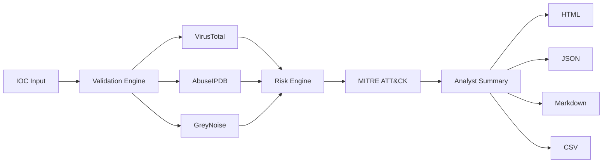
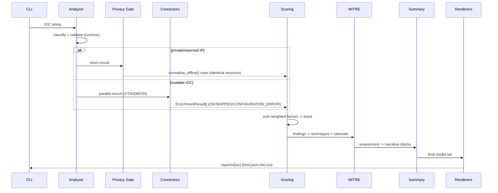
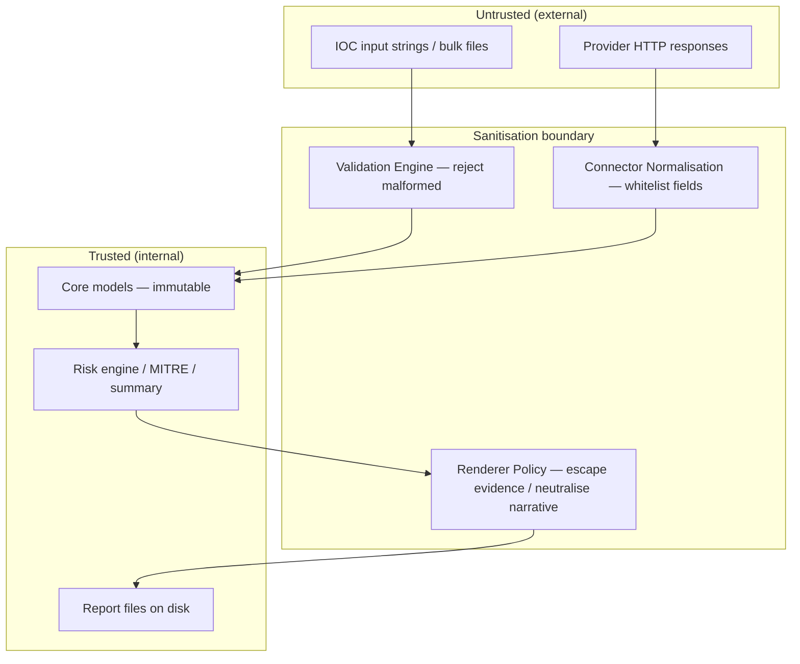

# Architecture — IOC Intelligence Analyzer

**Audience:** Security architects, senior engineers, evaluators.
**Status:** Release 1.0.0 (CLI monolith; API/dashboard layers planned behind stable seams).

---

## 1. System Goals

| Goal | How it is met |
|---|---|
| **Defensible triage in seconds** | One pipeline: validate → enrich → score → map → report |
| **Explainability** | Every point awarded is a `ScoreFactor` with rationale; every ATT&CK mapping carries evidence |
| **Determinism** | Identical inputs + identical provider payloads ⇒ byte-stable scores and bands |
| **Failure tolerance** | Provider outage never crashes the run or inflates risk; degraded rows are explicit |
| **Privacy by default** | Private/reserved IPs never leave the host; offline mode; no telemetry whatsoever |
| **Report safety** | Hostile IOCs cannot execute in any generated artifact (XSS/CSV-injection defences) |
| **Extensibility** | New providers plug in via one abstract base class; new formats via one renderer interface |

## 2. Design Principles

1. **Thin transport, rich core.** `main.py` parses arguments and calls services; zero business logic lives in the CLI. This keeps the future FastAPI layer a pure adapter.
2. **Normalise at the edge.** Every connector converts vendor JSON into one internal `EnrichmentResult` shape before anything else sees it. Scoring, MITRE and renderers never touch raw vendor payloads.
3. **Frozen data structures.** Models (`app/core/models.py`) are immutable dataclasses/enums — nothing downstream can mutate an assessment mid-pipeline.
4. **Explicit degradation states.** `OK`, `SKIPPED`, `CONFIGURATION_ERROR`, `ERROR` are first-class statuses carried in identical row structures on *all* analyzer paths (including private/reserved short-circuits), so consumers can rely on schema stability.
5. **Evidence vs narrative separation.** A deliberate, documented split (see §6) governs how untrusted IOC strings are rendered everywhere.
6. **No hidden state.** Configuration flows from environment once (`AppConfig.from_env()`); connectors are stateless HTTP adapters.

## 3. Security Principles

- **Least privilege egress:** outbound calls only to configured provider endpoints, bounded by timeout/retry caps.
- **Data minimisation:** private RFC1918/loopback/link-local addresses are filtered before enrichment.
- **Injection-safe output:** context-aware sanitisation (escape for evidence, neutralise for narrative; CSV formula guarding; path-traversal-safe filenames).
- **Secret hygiene:** keys exist only in env/`.env`; config repr redacts them; tests enforce that no key material appears in logs or reports.
- **Fail closed on validation, fail open on availability:** malformed IOCs are rejected, but a dead provider never blocks reporting of the rest.

## 4. Component Breakdown

```
main.py                      CLI transport (argparse, exit codes, console table)
app/
├── core/
│   ├── ioc.py               Type detection + strict validators (IP/domain/URL/hash/email),
│   │                        _is_valid_hostname() (RFC-1123, label≤63, host≤253), validate_many()
│   ├── models.py            IOC, EnrichmentResult, ScoreFactor, RiskAssessment, MitreTechnique,
│   │                        risk bands (score_to_level)
│   ├── config.py            AppConfig.from_env(); secret-redacting repr
│   └── logging.py           Human/JSON log formatters, level control
├── connectors/
│   ├── base.py              BaseConnector: retry/backoff/timeout, normalise_offline(),
│   │                        status constants (OK/SKIPPED/CONFIGURATION_ERROR/ERROR)
│   ├── virustotal.py        VT v3 -> EnrichmentResult (malicious counts, categories)
│   ├── abuseipdb.py         AbuseIPDB v2 -> confidence, categories (preserves False/0 values)
│   ├── greynoise.py         GN verdict/classification, Tor signal
│   └── future_stubs.py      OTX, URLHaus, Shodan, WHOIS, DNS — structured SKIPPED rows
├── services/
│   ├── analyzer.py          Orchestration: classify → privacy gate → fan-out enrich → aggregate
│   ├── scoring.py           Deterministic engine; frozen SCORING_RULES; explainable factors
│   ├── mitre.py             Evidence-based ATT&CK rule table (tactic/technique/rationale)
│   ├── summary.py           Analyst narrative generator (exec summary, actions, escalation)
│   └── demo.py              Synthetic full-pipeline dataset for --demo
└── reporting/
    ├── html_report.py       CSP-hardened HTML; _evidence()=html.escape, _neutralize_text() narrative
    ├── json_report.py       Stable machine-readable schema (SOAR/SIEM ingestion)
    ├── markdown_report.py   Ticket/wiki-ready output
    ├── csv_report.py        Formula-injection-neutralised export
    ├── console_report.py    Rich terminal tables
    └── utils.py             Filename sanitisation, shared helpers
```

### Layer responsibilities & contracts

| Layer | Input | Output | Contract |
|---|---|---|---|
| Validation | raw string | typed `IOC` or rejection reason | single validator used by CLI, bulk, URLs, `validate_many()` |
| Connectors | typed IOC | `EnrichmentResult` | same row structure on success, skip, config-error, offline |
| Risk engine | IOC + results | `RiskAssessment` | errors add 0 points; factors always present |
| MITRE | `RiskAssessment` + results | techniques[] | only evidence-backed assertions |
| Summary | everything above | narrative blocks | narrative-only neutralisation |
| Renderers | final model set | artifacts | evidence verbatim-escaped; filenames sanitised |

## 5. Data Flow



Detailed sequence for one indicator:



## 6. Trust Boundaries



Three boundaries are enforced:
1. **Input boundary** — nothing enters the model layer without passing `_is_valid_*` checks; hostile-but-valid IOCs (e.g., XSS payloads inside URL paths) are retained as *data*.
2. **Provider boundary** — vendor JSON is whitelisted into `EnrichmentResult.details`; unexpected keys are dropped, never propagated.
3. **Output boundary** — the **evidence/narrative policy**:
   - *Evidence fields* (IOC value display, indicator details, provider-tagged observed artifacts): `html.escape(payload)` only → forensic fidelity, inert rendering.
   - *Narrative fields* (title, executive summary, threat assessment, recommendations, escalation prose): `_neutralize_text(payload)` → character stripping plus `on*=`/`javascript:` neutralisation before escaping.
   - The ordering mistake `escape(_neutralize_text(...))` is explicitly prohibited in evidence slots; narrative slots escape last as a defence-in-depth measure.

## 7. Threat Model (STRIDE-lite)

| Threat | Example | Mitigation | Residual risk |
|---|---|---|---|
| **Spoofed input** | Malformed/hostile IOC masquerading as domain | Strict validators; canonical type classification | Valid-but-offensive strings accepted as data (by design) |
| **Tampering** | Bulk file with embedded headers/trailers | Header token skip-list (`ioc`, `indicator`, `value`, `ioc_value`); dedupe | – |
| **Repudiation** | "Why did this score 75?" | ScoreFactor rationales persisted in all formats | Weights require governance sign-off to change |
| **Information disclosure** | Internal IP sent to vendor; key in log | Privacy gate pre-enrichment; env-only secrets; redacted repr | Provider ToU still applies to public IOCs |
| **Denial of service** | Vendor hang / retry storm | Timeouts, capped retries, backoff; offline mode | Slow runs when many providers time out |
| **Elevation of privilege** | Stored XSS via report opened in browser | Evidence/narrative split, CSP meta, no inline JS | Analyst must use modern browser (CSP enforcement) |
| **Formula injection** | `=cmd|...` IOC exported to CSV then opened in Excel | Leading `= + - @` prefixed/neutralised per cell | Users should avoid legacy macro-enabled workflows |
| **Path traversal** | `../../etc/passwd` as "filename" IOC | Dot-run collapse + charset allowlist in filename sanitiser | – |

## 8. Extension Points

| Seam | How to extend | Stability |
|---|---|---|
| **Providers** | Subclass `BaseConnector`; implement `enrich()` returning `EnrichmentResult`; register in analyzer factory. Use `normalise_offline()` for non-routable types. | Core contract since 1.0 |
| **Scoring weights** | Edit frozen `SCORING_RULES` table (values only). Algorithm untouched. | Frozen intentionally; changes = release decision |
| **MITRE rules** | Append `_Pattern` rows to the ordered rule table. | Additive only |
| **Report formats** | Implement `render(assessment_set) -> str` and register with the CLI format parser. | Interface stable |
| **Stubs → real** | Replace `_PlannedConnector` bodies (OTX/URLHaus/Shodan/WHOIS/DNS) without touching callers — row structure already guaranteed. | Designed for this |

## 9. Future API Layer (v2.0 preview)

The CLI is deliberately a thin adapter so a FastAPI app can reuse `app.services.analyzer` unchanged. Planned: `POST /analyze`, `POST /bulk-analyze`, `GET /report/{id}`, `GET /health`, `GET /version`; bearer auth + RBAC; SQLite persistence of assessments; auto-generated OpenAPI. See [API_GUIDE.md](API_GUIDE.md).

## 10. Future Dashboard Layer (v3.0 preview)

Streamlit front-end over the v2.0 API: queue-driven analysis, MITRE heatmaps, historical IOC search, trend analytics. Renderer layer gains PDF/interactive variants without model changes.

## 11. Future Sentinel Integration (v4.0 preview)

Log-Analytics Data Connector shipping JSON assessments into Microsoft Sentinel; playbook-triggering on High/Critical bands; Splunk/Elastic/QRadar follow the same exporter pattern.

---

*Document version: 1.0.0 · Maintained with the code; update alongside CHANGELOG entries.*
